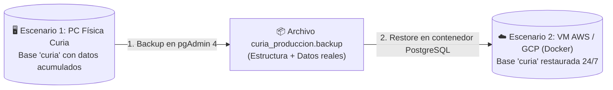

# Propuesta de Arquitectura, Operación, Respaldos y Escalamiento
**Proyecto:** Sistema de Gestión para la Curia de Cuenca (*ECLESOFT 2.0 / AplicacionCuria*)  
**Propósito de este documento:** Documento de trabajo y sustento técnico para presentar al profesor/director del proyecto las decisiones de despliegue (Escenario 1 Físico vs. Escenario 2 Nube), la arquitectura de conexión entre equipos, la estrategia automatizada de respaldos y los hallazgos técnicos encontrados al levantar el sistema desde cero.

---

## 1. Funcionamiento en Producción: Arquitectura Cliente-Servidor

El sistema está construido en **ASP.NET Core 8.0 MVC** con base de datos **PostgreSQL**. Al ser una aplicación web centralizada:

* **No se instala nada en las computadoras de las secretarias, despachos o parroquias.**
* Toda la instalación (motor de base de datos PostgreSQL + servidor web de la aplicación) reside **únicamente en 1 Máquina Principal (Servidor)**.
* Todas las demás computadoras actúan como **clientes ligeros**: únicamente abren su navegador web (*Chrome, Edge, Firefox*), ingresan a la dirección IP o dominio del servidor principal, inician sesión con su cuenta y trabajan sobre la misma base de datos unificada en tiempo real.

```mermaid
flowchart LR
    subgraph Equipos Clientes (Sin instalación adicional)
        PC1["💻 PC Secretaría 1\n(Navegador Web)"]
        PC2["💻 PC Secretaría 2\n(Navegador Web)"]
        PC3["💻 PC Párroco / Despacho\n(Navegador Web)"]
    end

    subgraph Máquina Principal (Servidor Central)
        APP["⚙️ Servicio AplicacionCuria\n(.NET 8 - Puerto 5155)"]
        DB[("🐘 PostgreSQL 18\nBase de datos: curia\n(Puerto 5432)")]
        APP -->|"localhost:5432"| DB
    end

    PC1 -->|"http://IP_SERVIDOR:5155"| APP
    PC2 -->|"http://IP_SERVIDOR:5155"| APP
    PC3 -->|"http://IP_SERVIDOR:5155"| APP
```

---

## 2. Escenarios de Implementación y Plan de Escalamiento

Siguiendo los lineamientos del proyecto, se plantean **dos etapas evolutivas (Escenario 1 $\rightarrow$ Escenario 2)** que son 100% compatibles entre sí (no requieren reprogramar la aplicación al pasar de una etapa a la otra).

### Escenario 1 (Etapa Inicial): Servidor Físico Local en la Curia (Windows)
* **Cómo opera:** Se designa una computadora principal dentro de la Curia como servidor local. En ella se instala PostgreSQL y se publica `AplicacionCuria`.
* **Requisito operativo clave:** Al ser una máquina física local, **esta computadora principal debe permanecer encendida** durante toda la jornada laboral para que las demás computadoras de la red puedan acceder al sistema.
* **Arranque totalmente desatendido (Sin consolas abiertas):**
  Para evitar que el personal administrativo tenga que ejecutar comandos manuales (`dotnet run`) o que alguien cierre por accidente una ventana de consola y deje sin servicio a la Curia, ambos componentes se configuran como **Servicios de Windows con Inicio Automático**:
  1. **PostgreSQL (`postgresql-x64-18`):** Se registra automáticamente como servicio de Windows al instalarse y arranca solo apenas se enciende el computador.
  2. **AplicacionCuria (`ServicioCuria`):** Se publica el ejecutable compilado (`dotnet publish -c Release`) y se registra como Servicio de Windows (`sc.exe create ... start= auto`) con reinicio automático en caso de fallo.
  * **Resultado:** Basta con presionar el botón físico de encendido del CPU en la mañana para que todo el sistema quede activo en segundo plano, incluso antes de iniciar sesión en Windows.

### Escenario 2 (Etapa Futura de Escalamiento): Virtualización en la Nube (AWS / Google Cloud) con Docker
* **Cómo opera:** El sistema se despliega en una máquina virtual en la nube (**AWS EC2** o **Google Compute Engine**) utilizando contenedores **Docker** (`docker compose up -d`), levantando los servicios de base de datos, administración (`pgAdmin`) y aplicación web.
* **Ventaja principal frente al Escenario 1:**
  * **Independencia física total:** Ya **no se necesita tener ninguna computadora principal prendida en la Curia**. El servidor vive en la nube encendido **24/7 los 365 días del año**.
  * **Acceso multi-parroquia:** Cualquier parroquia o institución afiliada a la Curia de Cuenca (desde distintos puntos geográficos de la ciudad) puede conectarse en cualquier momento a través de Internet de forma centralizada.

### ¿Cómo se migra del Escenario 1 al Escenario 2 sin perder datos?
Cuando el sistema lleve meses operando en la máquina física (Escenario 1) y se decida dar el salto a la nube (Escenario 2):
1. **No se ejecuta un script de tablas vacías**, sino que desde **pgAdmin 4** en la máquina física se genera un archivo de respaldo completo (`Backup` / `pg_dump`), el cual empaqueta tanto las 24 tablas como todos los datos reales ingresados hasta esa fecha.
2. En la máquina virtual de la nube se levantan los contenedores con `docker compose up -d`.
3. Desde el **pgAdmin** de la nube se restaura (`Restore` / `pg_restore`) el archivo `.backup`, dejando el sistema en la nube con el 100% del historial intacto en cuestión de minutos.



### Cuadro Comparativo: Escenario 1 vs. Escenario 2

| Criterio | Escenario 1: Máquina Física Principal (Local) | Escenario 2: Nube AWS / Google Cloud (Docker) |
| :--- | :--- | :--- |
| **Dependencia de equipo encendido** | **Sí.** La máquina principal física debe estar encendida para que las demás PCs accedan. | **No.** El servidor en la nube está activo 24/7; ninguna PC local necesita estar encendida para dar servicio. |
| **Alcance de conexión** | Computadoras dentro de la misma red local (LAN/Wi-Fi) de la oficina. | Cualquier parroquia afiliada o despacho desde cualquier ubicación con acceso autorizado. |
| **Arranque de servicios** | Automático al encender el CPU mediante **Servicios de Windows** (`start= auto`). | Automático y permanente mediante políticas de Docker (`restart: always`). |
| **Horario ideal de respaldos** | Dentro del horario de encendido de la máquina (al iniciar el lunes, al mediodía y/o al apagar el equipo). | Automático a la **medianoche / madrugada (ej. 02:00 AM)** con cero usuarios conectados. |
| **Vulnerabilidad ante cortes de luz** | Depende de la energía del edificio (requiere **UPS** en la máquina principal). | Inmune a cortes de luz locales en Cuenca; si se va la luz en una oficina, los datos en la nube no sufren ningún riesgo. |

---

## 3. Estrategia y Automatización de Respaldos (Backups)

### 3.1 Análisis de la demanda en la Curia
En la dinámica real de una Curia y sus parroquias, la carga fuerte de registros sacramentales (bautizos, matrimonios, catequesis, misas y pagos) se concentra hacia **viernes, sábado y domingo**. Por el contrario, el **lunes por la mañana** es el momento de menor demanda transaccional y marca el cierre natural de todo lo registrado durante el fin de semana.

### 3.2 Esquema propuesto: Respaldo Semanal Consolidado + Respaldos Diarios con Rotación Automática
Para evitar la duplicación innecesaria de archivos pesados que saturen el disco duro de la máquina con el paso de los meses, se propone un esquema de **rotación con limpieza automática**:

1. **Respaldo Maestro Semanal (Cada Lunes al encender el equipo):**
   * Apenas se enciende la máquina el día **lunes**, una tarea programada genera el respaldo completo consolidado de toda la semana anterior (`curia_semanal_YYYY_WXX.backup`).
   * **Rotación / Limpieza automática ("tumbar" los anteriores):** Una vez confirmado que el respaldo semanal del nuevo lunes se creó con éxito, el script **elimina automáticamente los respaldos diarios pequeños de la semana anterior** y rota el respaldo semanal antiguo (conservando únicamente una ventana controlada, por ejemplo, las últimas 2 a 4 semanas).
2. **Respaldos Diarios (Martes a Domingo) y Protección del Mismo Día:**
   * **El riesgo detectado:** Si únicamente se hiciera respaldo en la mañana al prender el computador, el respaldo del martes por la mañana solo tendría los datos del lunes. Si ocurriera un **corte de energía eléctrica (apagón)** el martes a las 4:00 PM, se pondría en riesgo lo trabajado durante ese mismo martes.
   * **Solución técnica para proteger el mismo día sin frenar el sistema:**
     * **Peso y velocidad real:** Dado que las 24 tablas del sistema almacenan principalmente texto (y solo firmas/fotos pequeñas en binario), un respaldo comprimido con `pg_dump -Fc -Z 9` pesa apenas entre **5 MB y 30 MB** y tarda **menos de 2 segundos**. Además, PostgreSQL utiliza *MVCC* (*Control de Concurrencia Multiversión*), por lo que hacer el respaldo **no bloquea las tablas ni interrumpe a las secretarias** aunque estén guardando registros en ese instante.
     * **Ejecución al cierre de jornada (Script de Apagado de Windows) y/o corte de mediodía:** Se configura Windows para que, al momento de apagar el equipo al final de la tarde (y opcionalmente al mediodía en hora de almuerzo), ejecute automáticamente el respaldo diario en 2 segundos, asegurando los datos registrados **ese mismo día**.
     * **Protección ante cortes de luz mediante UPS con conexión USB:** Conectando el servidor físico a un **UPS con cable de datos USB**, Windows detecta instantáneamente cuando se corta la energía eléctrica y el equipo pasa a batería. Esto permite disparar automáticamente el respaldo de emergencia de 2 segundos e iniciar el apagado seguro de Windows antes de que la batería del UPS se agote.
     * **Copia fuera del disco local:** La carpeta de respaldos semanales (`C:\RespaldosCuria\Semanales`) se vincula con una carpeta sincronizada en la nube institucional (*Google Drive / OneDrive*) o unidad externa, de modo que si el disco duro físico sufriera un daño eléctrico, los respaldos estén a salvo fuera de esa máquina.

---

## 4. Hallazgos Técnicos Encontrados en las Pruebas (VM Windows 11) y Mejoras para la `Guia/`

Al realizar la instalación real paso a paso en la Máquina Virtual con Windows 11 y probar la conexión desde una segunda máquina cliente, identificamos los siguientes puntos que estamos corrigiendo y documentando en la carpeta `Guia/`:

1. **Prioridad de archivos de conexión (`appsettings.Development.json` vs `appsettings.json`):**
   * En modo desarrollo (`dotnet run` / Visual Studio), ASP.NET Core toma la cadena de conexión de `appsettings.Development.json` (que apunta a `Database=curia`), sobreescribiendo a `appsettings.json`. Esto debe quedar explícito en el capítulo de instalación de la guía.
2. **Sincronización del script SQL (`TablasNuevo.sql`) con Entity Framework Core (`ConexionPostgreSQL.cs`):**
   * El código C# actual evolucionó respecto al script SQL original y requiere que las 24 tablas coincidan exactamente con los `DbSet` de `ConexionPostgreSQL.cs` (por ejemplo: tabla `personas_evento`, columnas de recordatorios en `agendas`, columna `firma` en `sacerdotes`, `sacerdote_id` en `actasbautismo` y `bautismosantiguos`, `catequista_id2` y `paralelo` en `alumnoscatequesis`).
3. **Creación del primer usuario Administrador y Roles:**
   * En el código C#, los controladores verifican `[Authorize(Roles = "admin")]` en minúsculas, mientras que `TablasNuevo.sql` insertaba `'ADMINISTRADOR'` en mayúsculas y el formulario público `/Auth/Register` omitía el campo `Rol` requerido por `UsuarioRegisterRequest`.
4. **Política de Cookies para conexión desde otras computadoras en Red Local (`Program.cs`):**
   * `Program.cs` tenía `options.Cookie.SecurePolicy = CookieSecurePolicy.Always;`. Esto funciona en `http://localhost`, pero cuando una segunda computadora de la Curia se conecta por dirección IP (`http://192.168.x.x:5155`) sin HTTPS, el navegador bloquea la cookie de inicio de sesión. Cambiarlo a `CookieSecurePolicy.SameAsRequest` (o `None` en red local HTTP) permite que todas las computadoras de la red inicien sesión sin rebote.
5. **Ajustes necesarios en Docker para el Escenario 2 (`Dockerfile` y `docker-compose.yml`):**
   * En `docker-compose.yml`, el servicio `curia` define variables `DB_HOST`/`DB_NAME` en lugar de `ConnectionStrings__DefaultConnection`.
   * La generación de PDFs en `Program.cs` invoca `../Rotativa/Windows/wkhtmltopdf.exe` (binario de Windows), por lo que para correr dentro de un contenedor Docker Linux en el Escenario 2 se debe incluir el binario `wkhtmltopdf` para Linux o desplegar sobre contenedor/instancia compatible.

---

## 5. Puntos a Consultar y Validar con el Profesor / Director del Proyecto

1. **Alcance de entrega actual:** Confirmar si en esta fase dejamos implementado y documentado el **Escenario 1 (Servidor físico local en Windows con servicios automáticos)** dejando preparado y documentado el paso al **Escenario 2 (Docker / Nube)**, o si también levantaremos el entorno Docker desde ahora.
2. **Validación de la política de respaldos:** Confirmar si está de acuerdo con el esquema **Semanal Consolidado (Lunes) + Diario con rotación automática y respaldo al apagado del equipo**.
3. **Horario operativo en la Curia (para el Escenario 1):** Confirmar a qué hora se enciende y a qué hora se apaga habitualmente el computador principal en la oficina, y si el equipo contará con un **UPS conectado por USB**.
